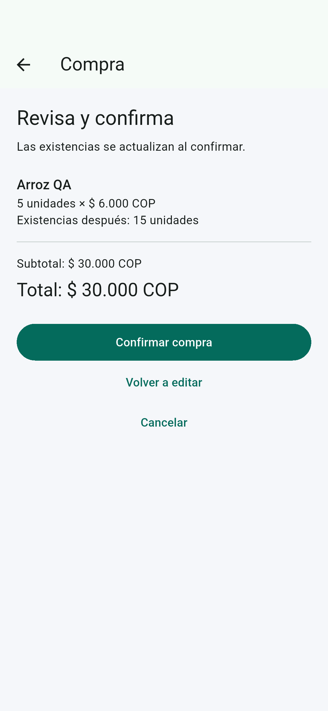
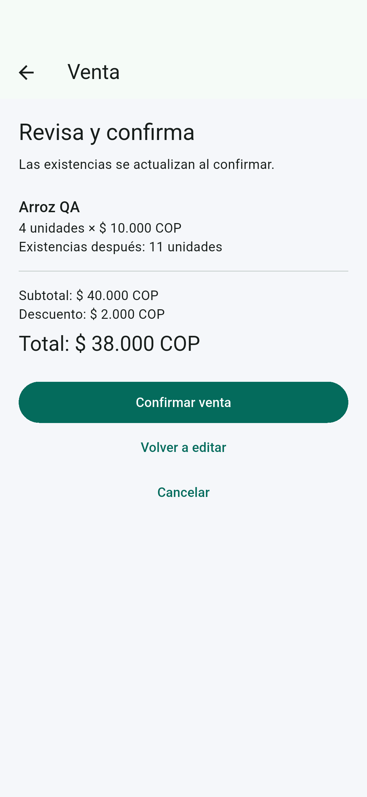
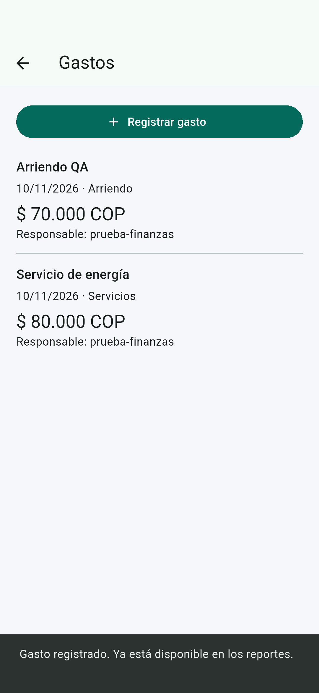
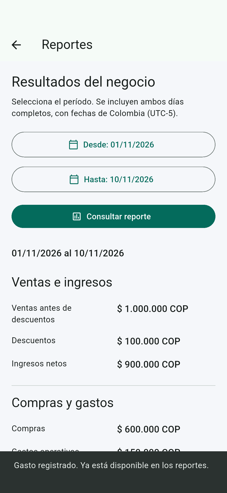
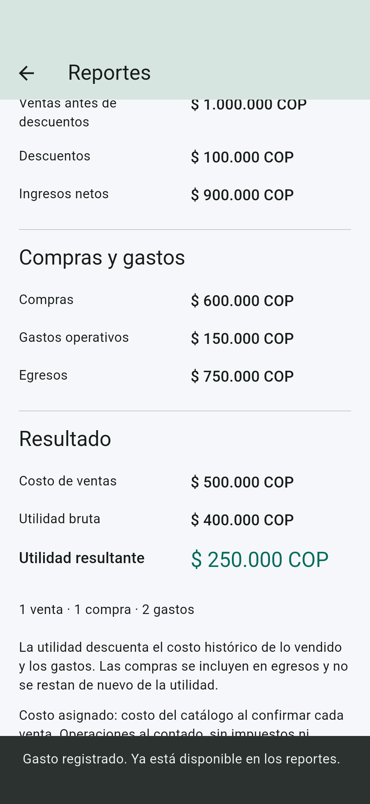

# Manual de usuario de FinanzAsist

- **Equipo:** Los Juanchos · Ingeniería Informática, UNIPAZ.
- **Versión del manual:** 4 · 16 de noviembre de 2026.
- **Alcance:** cuentas locales, acceso, productos, inventario, compras, ventas, costos históricos, gastos y reportes.
- **Estado:** preparado a partir de la aplicación actual; revisión del equipo y validación con usuarios pendientes.

Este manual explica cómo utilizar las funciones disponibles. Las capturas contienen datos ficticios de pruebas independientes: sus nombres, fechas y valores pueden diferir de los del ejercicio completo de la sección 11.

## Contenido

1. [Primer uso y datos guardados](#1-primer-uso-y-datos-guardados)
2. [Moverse por la aplicación](#2-moverse-por-la-aplicación)
3. [Registrar y editar productos](#3-registrar-y-editar-productos)
4. [Consultar existencias](#4-consultar-existencias)
5. [Registrar existencias iniciales](#5-registrar-existencias-iniciales)
6. [Ajustar existencias](#6-ajustar-existencias)
7. [Registrar compras](#7-registrar-compras)
8. [Registrar ventas](#8-registrar-ventas)
9. [Registrar gastos](#9-registrar-gastos)
10. [Consultar reportes](#10-consultar-reportes)
11. [Ejercicio completo de prueba](#11-ejercicio-completo-de-prueba)
12. [Resolver problemas frecuentes](#12-resolver-problemas-frecuentes)
13. [Funciones pendientes y ayuda](#13-funciones-pendientes-y-ayuda)

## 1. Primer uso y datos guardados

Abre FinanzAsist en el teléfono o emulador Android donde el equipo haya instalado la aplicación. Si aún necesitas instalarla, solicita al equipo la APK y las instrucciones correspondientes. La [guía del proyecto](../README.md#ejecutar) contiene los comandos de ejecución para desarrollo.

### Crear la cuenta de tu empresa

1. En **Inicia sesión**, pulsa **Crear cuenta de empresa**.
2. Completa **Nombre de la empresa**, **Tu nombre** y **Correo electrónico**.
3. Crea una **Contraseña** de 8 a 128 caracteres y repítela en **Confirmar contraseña**. Puedes utilizar una frase con espacios. El icono del ojo permite revisar lo escrito.
4. Pulsa **Crear cuenta y entrar** y espera la confirmación. Entrarás al Inventario como propietario.

El correo identifica tu cuenta en este dispositivo: se ignoran las mayúsculas y los espacios de los extremos. Si ya está registrado, utiliza **Ya tengo cuenta · Iniciar sesión**. Los errores de validación conservan los demás datos escritos.

La primera cuenta vincula los registros de la empresa local anterior, si existen. Sus movimientos históricos conservan el responsable original; los registros nuevos utilizan tu usuario. Las demás cuentas empiezan con una empresa vacía y no muestran los datos de las otras.

### Entrar y salir

Para entrar, escribe el correo y la contraseña en **Inicia sesión** y pulsa **Iniciar sesión**. En Inventario verás el nombre de tu empresa. Para salir, abre **Cuenta de empresa**, el icono de usuario de la barra superior, y selecciona **Cerrar sesión**. La aplicación vuelve al acceso y retira el historial de pantallas privadas.

Las cuentas se guardan en este dispositivo. Al reiniciar la aplicación deberás entrar de nuevo. El correo se utiliza como identificador; no se envía un mensaje de verificación y no existe recuperación de contraseña por correo. Guarda tus credenciales: el equipo no puede recuperar la contraseña original.

| Forma de uso | Qué ocurre con los datos |
| --- | --- |
| Aplicación Android normal | Solicita acceso. La primera cuenta conserva los datos locales anteriores, si existen. Las otras empresas empiezan vacías. Los productos, movimientos, compras, ventas y gastos permanecen al cerrar sesión o reiniciar. |
| Demostración | Presenta la etiqueta «Demostración · datos ficticios, sin guardar en disco». Sus cambios son temporales y no debes esperar recuperarlos al reiniciar. |
| Versión web | Utiliza la demostración en memoria; no conserva registros como la aplicación Android normal. |

El equipo selecciona el modo al ejecutar la aplicación; no existe un interruptor dentro del menú para cambiar entre modo normal y demostración. Si ves «Escenarios de prueba», son controles de la demostración: cambiar de escenario reinicia sus registros ficticios.

Los datos de Android se guardan en el dispositivo. Esta versión no ofrece sincronización, exportación, copia de seguridad ni restauración desde sus pantallas. Antes de borrar los datos de la aplicación o desinstalarla, solicita al equipo un procedimiento de respaldo si necesitas conservar tus registros.

## 2. Moverse por la aplicación

En la primera visita a cada módulo verás una guía con su propósito y cómo empezar. Pulsa **Ver pasos** para ampliar las instrucciones o **Entendido** para ocultarlas. Puedes consultarlas después desde **Guía de Inventario**, **Guía de Compras**, **Guía de Ventas**, **Guía de Gastos** o **Guía de Reportes**. La aplicación recuerda esta elección para tu cuenta.

Después de iniciar sesión aparece **Inventario**. La barra inferior permanece disponible en todos los módulos y sus formularios:

| Destino | Para qué sirve |
| --- | --- |
| Inventario | Ver productos y unidades disponibles; abrir el detalle, crear o editar productos y registrar movimientos. |
| Compras | Registrar entradas de mercancía y consultar compras confirmadas. |
| Ventas | Registrar salidas, descuentos y consultar ventas con su costo histórico y utilidad bruta. |
| Gastos | Registrar y consultar gastos operativos. |
| Reportes | Consultar resultados de un período. |

Para cambiar de módulo, selecciona directamente otro destino de la barra inferior. Al volver encontrarás la búsqueda, el período consultado, la posición de la lista y el formulario que estabas preparando. Inventario, historiales y reportes se actualizan cuando guardas cambios en otro módulo.

Utiliza la flecha superior o el botón de regreso de Android para volver desde un detalle o formulario. Si has modificado un producto, una operación o un gasto, podrás elegir **Seguir editando** o **Descartar cambios**. Un formulario sin cambios se cierra directamente. Desde la pantalla principal de otro módulo, regresar lleva a Inventario.

Los borradores se conservan al cambiar de módulo mientras la sesión y la aplicación permanecen abiertas. No se guardan en disco: cerrar sesión, reiniciar o perder el proceso puede eliminarlos. Confirma o guarda el registro para conservarlo.

En los formularios puedes desplazarte verticalmente para llegar a los campos y botones cuando el teclado esté abierto. Durante un guardado, el botón queda deshabilitado y muestra un indicador; también se bloquean el regreso y el cambio de módulo hasta terminar. Espera la confirmación antes de repetir la operación.

### Cómo escribir cantidades e importes

- Las cantidades de productos son **unidades enteras**: por ejemplo, `5`.
- Los importes están en **pesos colombianos (COP)**. Escribe `6000` para seis mil pesos, sin `$` ni separadores de miles.
- Si necesitas centavos, utiliza hasta dos decimales: por ejemplo, `6000,50`. También se acepta el punto decimal.
- Debajo de cada campo monetario válido aparece **Se registrará:** con el importe en COP. Por ejemplo, `6000,50` se muestra como **$ 6.000,50 COP**.
- `6.000`, `6,000`, `1.000.000` y los importes con espacios o más de dos decimales se rechazan. Para seis mil, escribe `6000`; revisa la equivalencia antes de guardar.

## 3. Registrar y editar productos

### Crear un producto

1. En Inventario, pulsa **+** en la parte superior. Si el inventario está vacío, también puedes pulsar **Registrar producto**.
2. Escribe el **Nombre del producto**.
3. Ingresa el **Costo de compra (COP)** por unidad.
4. Ingresa el **Precio de venta (COP)** por unidad.
5. Pulsa **Guardar producto**.

El nombre es obligatorio. El costo y el precio deben ser importes válidos y no negativos; pueden ser cero. Los errores aparecen junto al campo que debes corregir. Una vez guardado, el producto aparece en el inventario con **0 unidades**.

Para un producto que ya tiene mercancía disponible, continúa con el registro de existencias iniciales. Crear el producto no suma unidades por sí solo.

### Modificar un producto

1. Toca el producto en Inventario para abrir su detalle.
2. Pulsa **Editar producto**.
3. Modifica el nombre, el costo o el precio.
4. Pulsa **Guardar cambios**.

El producto conserva su identificador y sus existencias. El detalle y el inventario muestran los valores actualizados. Si regresas antes de guardar, los cambios del formulario no se aplican.

Editar el costo o el precio del catálogo no modifica las ventas anteriores. Las compras confirmadas conservan su propio costo unitario y no reemplazan automáticamente el costo del catálogo.

## 4. Consultar existencias

Utiliza **Buscar producto** para encontrarlo por nombre. Puedes escribir con o sin tildes y mayúsculas. El icono de cierre limpia la búsqueda; si no hay coincidencias, **Ver todos los productos** recupera el catálogo.

1. Abre Inventario.
2. Localiza el producto por su nombre y revisa la cantidad de unidades disponibles.
3. Tócalo para ver su identificador, cantidad, costo, precio y movimientos registrados.

Un producto con **0 unidades** aparece identificado como **Agotado**. Las compras confirmadas suman unidades, las ventas confirmadas las restan y los ajustes aplican la variación indicada.

El inventario se actualiza al volver de una operación confirmada. También puedes pulsar el icono de actualizar de la parte superior para consultar de nuevo las cantidades.

En el detalle, **Movimientos de inventario** permite revisar el tipo de movimiento, las unidades que entraron o salieron, el saldo posterior, el motivo, la fecha y el responsable. El saldo es la cantidad que quedó después de ese movimiento.

## 5. Registrar existencias iniciales

La apertura sirve para indicar cuántas unidades tenía un producto al comenzar su control en la aplicación.

1. Crea el producto y abre su detalle.
2. Pulsa **Registrar existencias iniciales**.
3. Verifica el producto seleccionado.
4. Escribe el conteo inicial, por ejemplo, `20`.
5. Escribe un **Motivo**, por ejemplo, «Inventario de apertura».
6. Pulsa **Revisar operación**.
7. Comprueba las unidades y el motivo; pulsa **Confirmar existencias iniciales**.

El producto pasa de 0 a 20 unidades y se registra el movimiento con fecha y responsable. La cantidad inicial no puede ser negativa y el motivo es obligatorio.

Esta opción solo aparece cuando el producto tiene 0 unidades y no tiene movimientos. La apertura se registra una sola vez, incluso si la cantidad registrada fue cero. Si ya hay movimientos, utiliza un ajuste o registra una compra, según lo que haya ocurrido.

## 6. Ajustar existencias

El ajuste corrige una diferencia entre las unidades registradas y el conteo físico.

1. Abre el detalle del producto.
2. Pulsa **Ajustar existencias**.
3. En **Variación de unidades (+ / −)**, escribe las unidades que entran o salen.
4. Escribe el **Motivo** de la corrección.
5. Pulsa **Revisar operación** y verifica la cantidad que quedará.
6. Pulsa **Confirmar ajuste de inventario**.

Por ejemplo, si la aplicación registra 20 unidades y cuentas 18, escribe **`-2`**, con motivo «Diferencia de conteo». El resultado debe ser 18. No escribas `18` en el campo de variación: eso sumaría 18 unidades.

El ajuste debe ser distinto de cero y no puede dejar existencias negativas. Un ajuste modifica unidades; no anula una compra o venta ni corrige su valor en los reportes.

## 7. Registrar compras

Antes de comenzar, el producto debe existir en el catálogo.

1. Desde Inventario, entra a **Compras**.
2. Pulsa **Registrar compra**.
3. Selecciona un **Producto**.
4. Ingresa la **Cantidad de unidades**, mayor que cero.
5. Revisa o modifica el **Costo unitario (COP)** propuesto.
6. Para incluir otro producto, pulsa **Agregar producto** y completa su línea. Para retirar una línea, utiliza su botón de quitar.
7. Pulsa **Revisar operación**.
8. Comprueba productos, cantidades, valores, total y existencias posteriores. Si necesitas corregir algo, pulsa **Volver a editar**.
9. Pulsa **Confirmar compra**.

Cada producto puede aparecer una sola vez: modifica su cantidad en la misma línea si necesitas más unidades. Los costos no pueden ser negativos.

**Ejemplo:** comprar 5 unidades a 6000 cuesta **$ 30.000 COP**. Si había 10 unidades, después de confirmar quedan **15**. La compra aparece en el historial y puedes expandirla para consultar su detalle, fecha, total y responsable.

*Captura de un resumen de compra con datos ficticios.*

Preparar el formulario o abrir el resumen no cambia el inventario. **Cancelar** antes de confirmar solicita descartar los datos modificados. **Seguir editando** conserva el formulario y **Descartar cambios** lo cierra sin guardar. También puedes cambiar de módulo y retomarlo mientras la aplicación y la sesión permanezcan abiertas.

## 8. Registrar ventas

1. Desde Inventario, entra a **Ventas**.
2. Pulsa **Registrar venta**.
3. Selecciona un **Producto** y revisa las unidades disponibles.
4. Ingresa la **Cantidad de unidades**, mayor que cero.
5. Revisa o modifica el **Precio cobrado por unidad (COP)**.
6. Utiliza **Agregar producto** si la venta incluye otros productos.
7. Ingresa el **Descuento total (COP)** o deja `0` si no hay descuento.
8. Pulsa **Revisar operación** y comprueba el resumen.
9. Pulsa **Confirmar venta**.

El descuento es un **importe en pesos sobre el total de la venta**, no un porcentaje ni un descuento por unidad. Debe estar entre cero y el subtotal. No se permiten precios negativos ni cantidades superiores a las existencias disponibles; las cantidades se comprueban otra vez al confirmar.

**Ejemplo:** vender 4 unidades a 10000 genera un subtotal de **$ 40.000 COP**. Con descuento total de 2000, el total cobrado es **$ 38.000 COP**. Si había 15 unidades, quedan **11**.

*Captura de un resumen de venta con datos ficticios.*

La venta confirmada aparece en el historial. Expándela para revisar precios cobrados, descuento, total, costo asignado por unidad, costo de ventas y utilidad bruta. El costo asignado es el costo del catálogo al confirmar la venta; se conserva aunque después edites el producto.

**Cancelar** antes de confirmar permite seguir editando o descartar los cambios; descartar no guarda la venta ni resta unidades. Si al confirmar aparece un aviso de existencias insuficientes, la venta no se registra; vuelve a revisar el inventario antes de preparar una cantidad distinta.

## 9. Registrar gastos

Los gastos corresponden a conceptos operativos, como energía, arriendo o transporte. Registra la adquisición de mercancía en **Compras** para que aumenten las existencias; no la registres otra vez como gasto operativo.

1. Desde Inventario, entra a **Gastos**.
2. Pulsa **Registrar gasto**.
3. Pulsa **Fecha del gasto**, elige el día y confirma con **Usar fecha**.
4. Escribe el **Concepto**, por ejemplo, «Servicio de energía».
5. Selecciona una **Categoría**: Servicios, Arriendo, Transporte, Insumos, Personal u Otros.
6. Ingresa el **Valor (COP)**, por ejemplo, `80000`.
7. Revisa los datos y pulsa **Guardar gasto**.

La fecha, el concepto y la categoría son obligatorios. El valor debe ser mayor que cero y tener hasta dos decimales. El gasto aparece en el listado con fecha, categoría, valor y responsable; no modifica existencias.

*Captura del listado de gastos de una prueba independiente.*

El reporte incluye el gasto según la fecha que seleccionaste, aunque lo hayas registrado otro día. **Cancelar** antes de guardar permite seguir editando o descartar los cambios; descartar no crea el gasto. Las categorías de esta versión son opciones fijas; todavía no hay una pantalla para administrarlas.

## 10. Consultar reportes

**Hoy**, **Últimos 7 días** y **Este mes** consultan automáticamente esos períodos. Para otras fechas, utiliza **Desde**, **Hasta** y **Consultar reporte**. Los siete días incluyen hoy y los seis anteriores.

1. Desde Inventario, entra a **Reportes**.
2. Revisa **Desde** y **Hasta**. Al entrar se consulta desde el primer día del mes actual hasta hoy.
3. Para cambiar una fecha, pulsa su botón, elige el día y confirma con **Usar fecha**.
4. Pulsa **Consultar reporte**.
5. Desplázate para consultar todos los resultados.

Se incluyen ambos días completos según la fecha de Colombia (UTC-5). La fecha inicial no puede ser posterior a la final. Si cambias las fechas, se retira el resultado anterior hasta que consultes de nuevo.

Las compras y ventas toman su fecha al confirmarse. Los gastos utilizan la fecha elegida en su formulario. Asegúrate de que las operaciones que quieres revisar estén dentro del período.

*Captura de selección de período y resultados con datos ficticios.*

### Entender los resultados

| Resultado | Qué representa |
| --- | --- |
| Ventas antes de descuentos | Suma de cantidades vendidas por precios cobrados, antes del descuento total. |
| Descuentos | Suma de los descuentos aplicados a las ventas. |
| Ingresos netos | Ventas antes de descuentos menos descuentos. |
| Compras | Total de compras confirmadas en el período. |
| Gastos operativos | Gastos registrados con fecha dentro del período. |
| Egresos | Compras más gastos operativos. |
| Costo de ventas | Costo histórico asignado a las unidades vendidas. |
| Utilidad bruta | Ingresos netos menos costo de ventas. |
| Utilidad resultante | Utilidad bruta menos gastos operativos. |

Las compras se muestran en egresos; **no se restan otra vez de la utilidad**. La aplicación usa el costo del catálogo guardado al confirmar cada venta. No recalcula las ventas anteriores con el costo actual del producto.

*En esta prueba independiente, la utilidad resultante es $ 250.000 COP.*

Si no hay compras, ventas ni gastos en el período, los importes aparecen en cero y se informa que no hay operaciones. Un resultado negativo puede ser correcto: por ejemplo, si solo registraste gastos. Esta versión considera operaciones al contado y no incorpora impuestos, devoluciones ni operaciones a crédito.

## 11. Ejercicio completo de prueba

Utiliza un producto nuevo de prueba y un período sin otras compras, ventas ni gastos. Si ya existen operaciones dentro del período, el reporte también las incluirá. El ejercicio no requiere borrar registros anteriores.

| Paso | Qué registrar | Existencias esperadas |
| --- | --- | ---: |
| 1 | Producto «Arroz de prueba», costo 6000 y precio de venta 10000. | 0 |
| 2 | Existencias iniciales: 20; motivo «Inventario de apertura». | 20 |
| 3 | Ajuste: `-10`; motivo «Diferencia de conteo». | 10 |
| 4 | Compra: 5 unidades a 6000; revisar y confirmar total 30000. | 15 |
| 5 | Venta: 4 unidades a 10000; descuento total 2000; revisar y confirmar total 38000. | 11 |
| 6 | Gasto de transporte por 8000, con fecha del ejercicio. | 11 |
| 7 | Reporte del día del ejercicio, incluyendo compra, venta y gasto. | 11 |

Comprueba que el inventario y el detalle muestran **11 unidades**. Los resultados financieros esperados son:

| Indicador | Valor esperado |
| --- | ---: |
| Ventas antes de descuentos | $ 40.000 COP |
| Descuentos | $ 2.000 COP |
| Ingresos netos | $ 38.000 COP |
| Compras | $ 30.000 COP |
| Gastos operativos | $ 8.000 COP |
| Egresos | $ 38.000 COP |
| Costo de ventas: 4 × 6000 | $ 24.000 COP |
| Utilidad bruta | $ 14.000 COP |
| Utilidad resultante | $ 6.000 COP |

En Android normal, cierra y vuelve a abrir la aplicación: el producto y sus operaciones guardadas deben permanecer. Un formulario que todavía no guardaste no equivale a un registro confirmado.

## 12. Resolver problemas frecuentes

| Mensaje o situación | Qué hacer |
| --- | --- |
| «Aún no tienes productos» | Pulsa Registrar producto. Un inventario vacío no indica una falla de carga. |
| «No pudimos cargar el inventario» o un error de consulta | Pulsa Reintentar. Si persiste, anota la pantalla y el mensaje y comunícalos al equipo. |
| «Escribe el nombre del producto» | Completa el nombre; un texto compuesto solo por espacios no es válido. |
| «Correo o contraseña incorrectos» | Revisa el correo y la contraseña usados en este mismo dispositivo. El icono del ojo permite comprobar la escritura. |
| «Este correo ya tiene una cuenta» | Utiliza **Ya tengo cuenta · Iniciar sesión**. No se crea otra empresa con ese mismo correo. |
| «Usa entre 8 y 128 caracteres» | Usa al menos 8 caracteres, sin superar 128. Repítela en Confirmar contraseña. |
| Costo, precio o importe inválido | Escribe el valor sin separadores de miles y con máximo dos decimales. Costo y precio no pueden ser negativos. |
| «Indica el motivo del movimiento» | Explica la apertura o el ajuste en Motivo y revisa otra vez la operación. |
| La apertura no aparece o el producto ya tiene movimientos | No repitas la apertura. Utiliza Ajustar existencias o registra una compra según corresponda. |
| «No hay existencias suficientes» | Consulta el saldo actual. Corrige la cantidad o verifica una entrada real de mercancía antes de intentar vender. |
| El ajuste dejaría existencias negativas | Revisa la variación y el conteo físico; no puedes retirar más unidades que las disponibles. |
| El producto ya está en otra línea | Modifica la cantidad de la línea existente o quita la línea repetida. |
| «El descuento debe estar entre cero y el subtotal» | Ingresa un importe total en pesos entre 0 y el subtotal; no escribas un porcentaje. |
| «Selecciona una fecha válida» o «Selecciona una categoría» | Completa el campo indicado antes de guardar el gasto. |
| «El valor debe ser mayor que cero» | Ingresa un gasto positivo; cero y valores negativos no se guardan. |
| «La fecha inicial no puede ser posterior a la final» | Corrige Desde o Hasta y vuelve a pulsar Consultar reporte. |
| No hay operaciones en el reporte | Revisa el período. Compras y ventas usan su fecha de confirmación; gastos, su fecha seleccionada. |
| El botón está deshabilitado y muestra un indicador | La aplicación está procesando el guardado. Espera el resultado. Si informa un error, reintenta desde ese mismo formulario. |
| Los botones quedan debajo del teclado | Desplaza el formulario para llegar al botón o cierra el teclado. |
| Los datos desaparecen al reiniciar la demostración | Son datos temporales. Solicita al equipo la versión Android normal si necesitas registros persistentes. |

### Si confirmaste una operación equivocada

Las pantallas actuales no permiten editar, anular o devolver una compra o venta confirmada, ni editar o eliminar gastos. No registres otra operación como si fuera una anulación: modificaría los totales y podría duplicar el error.

Anota el módulo, la fecha, los productos o concepto y los valores esperados y registrados. En Compras y Ventas puedes expandir el registro y copiar su identificador de **Operación**. Entrega esta información al equipo para revisar la corrección. Un ajuste de inventario solo corrige unidades y no elimina el importe original de un reporte.

## 13. Funciones pendientes y ayuda

Todavía no están disponibles el acceso desde otros dispositivos, la recuperación de contraseña, la edición de cuentas y empresas, los usuarios adicionales y permisos por rol, las categorías administrables, los clientes, los proveedores, los gráficos, las anulaciones, la exportación y la sincronización. Los métodos de costo FIFO y promedio ponderado requieren una decisión posterior del equipo.

Para pedir ayuda a Los Juanchos, registra qué pantalla utilizabas, qué acción intentaste, qué mensaje apareció y qué resultado esperabas. Si adjuntas una captura, evita incluir datos personales o información de otros negocios.

La validación de este manual con personas usuarias y la revisión por otra persona del equipo siguen pendientes. Los resultados técnicos y las evidencias existentes se consultan en los [informes de Sprint 1](validacion-sprint1.md) y de [costos, gastos y reportes](validacion-finanzas.md).
