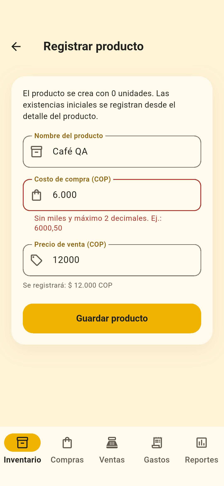
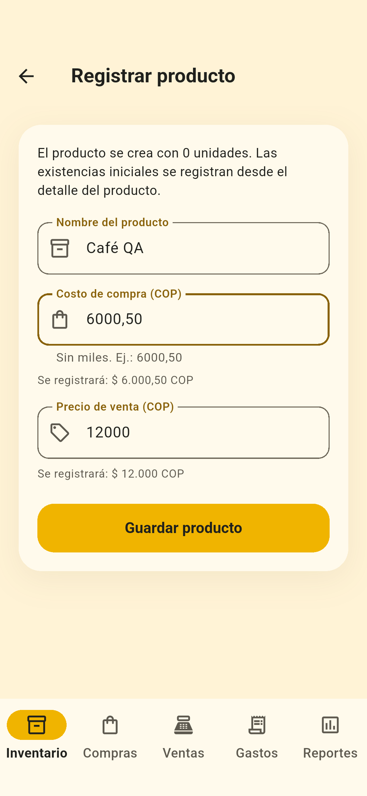
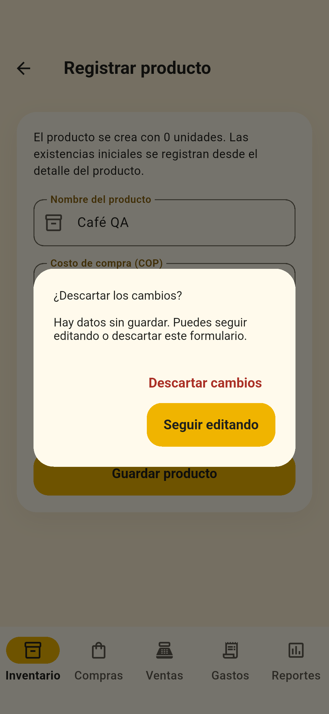
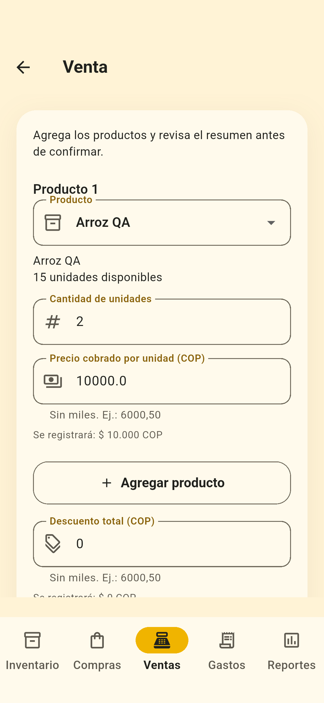
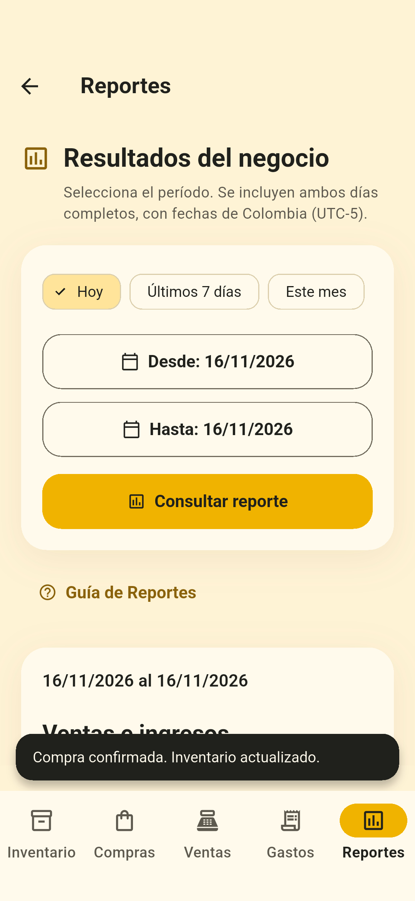
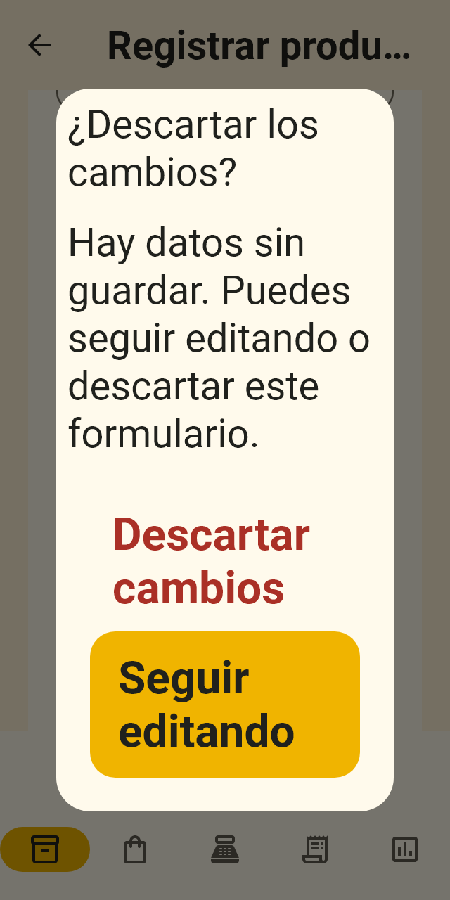
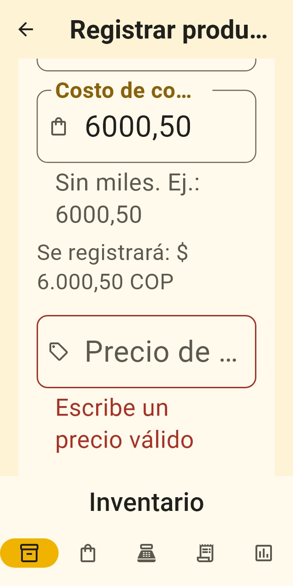

# Mejoras prioritarias de FinanzAsist 1.0.2

Implementación del 16 de noviembre de 2026. Atiende las dos prioridades P1 de la [revisión de la versión 1.0.1](mejoras-version-1.0.1.md) e incorpora la navegación compartida indicada en su primera P2. Conserva el diseño crema y dorado y las reglas financieras existentes.

## 1. Registrar dinero sin ambigüedad

Productos, compras, ventas, descuentos y gastos comparten una regla: escribir pesos sin agrupación de miles y utilizar punto o coma únicamente para uno o dos decimales. No se interpreta silenciosamente un separador de miles como seis pesos.

| Entrada | Resultado |
| --- | --- |
| `6000` | Aceptada: $ 6.000 COP. |
| `6000,50` o `6000.50` | Aceptada: $ 6.000,50 COP. |
| `6.000` o `6,000` | Rechazada: escribir `6000` para seis mil. |
| `1.000.000`, `1,000.00`, `1.234,50` o `6 000` | Rechazada: no utilizar agrupación de miles. |
| `6000,501` | Rechazada: máximo dos decimales. |

Cada campo monetario válido muestra **Se registrará:** con la equivalencia en COP. Los campos conservan sus reglas particulares: costos y precios no negativos, gasto mayor que cero y descuento dentro del subtotal. Se mantienen el cálculo en centavos y los límites de precisión.

La regla está centralizada en `EntradaImporte`; las validaciones de producto, operación y gasto la utilizan. La vista previa reutilizable es `VistaPreviaImporte`.




## 2. Proteger los cambios antes de salir

El registro y la edición de productos, las operaciones de inventario, las compras, las ventas y los gastos usan `ProtectorFormulario`.

- Volver o cancelar un formulario modificado ofrece **Seguir editando** y **Descartar cambios**.
- Seguir editando, cerrar el diálogo o pulsar fuera de él conserva el formulario.
- Descartar cierra el formulario sin crear ni modificar registros.
- Un formulario sin cambios se cierra directamente.
- Durante el guardado se bloquean el regreso y el cambio de módulo, además del envío repetido. Al finalizar se cierra el formulario y se actualizan los datos.
- Un fallo de guardado conserva los datos para reintentar.

El aviso distingue los cambios escritos de los valores iniciales del formulario. Se puede desplazar y sus botones se distribuyen verticalmente cuando falta ancho.



## 3. Cambiar directamente de módulo

La barra inferior permanece en Inventario, Compras, Ventas, Gastos y Reportes, incluidos detalles y formularios. `NegocioScreen` mantiene un navegador por destino y carga cada módulo en su primera visita.

Cambiar de destino conserva rutas, búsquedas, fechas del reporte, desplazamiento y formularios abiertos. Al guardar en otro módulo, las consultas se actualizan al regresar. Un detalle abierto renueva sus unidades y movimientos; una compra también renueva las existencias disponibles de una venta que estaba en preparación, sin sobrescribir sus cantidades, precios o descuentos.

El regreso de Android o la flecha superior cierra primero la ruta del módulo, con protección de cambios cuando corresponde. Desde la pantalla principal de Compras, Ventas, Gastos o Reportes, regresar lleva a Inventario. Cerrar sesión retira todos los navegadores privados.

**Límite del borrador:** se conserva en memoria durante la sesión. Cambiar de módulo permite retomarlo; cerrar sesión, reiniciar la aplicación o perder el proceso puede eliminarlo. Para conservar un registro hay que guardarlo o confirmar la operación. No se agregó almacenamiento de borradores en disco.




## Validación

- Análisis estático de Flutter sin incidencias.
- **138 pruebas aprobadas** de dominio, SQLite, acceso e interfaz, incluidas entradas ambiguas, salida con cambios, guardado en curso, navegación, detalle actualizado y compra con venta abierta.
- Recorridos Android en Pixel 5, Android 16 / API 36: mejoras con SQLite, registro/acceso/salida y gastos/costos históricos/reportes.
- Verificación visual de las capturas Android y de pantallas de 320 × 640 con texto al 200 %, usando Roboto e iconos Material. La equivalencia de dinero y las acciones del aviso permanecen legibles; las listas permiten desplazamiento. Las pruebas también ejercitan un teclado simulado.

El recorrido de las mejoras utiliza datos ficticios en una base aislada: apertura de 10 unidades, compra de 5 y venta de 2. El saldo es 13; la venta registra $ 20.000 COP de ingresos, $ 12.000 COP de costo histórico y un gasto de $ 6.000,50 COP deja $ 1.999,50 COP de utilidad. Se comprueba la persistencia al reabrir SQLite. Las bases de las pruebas se eliminan al terminar.

Comandos principales:

```powershell
flutter analyze --no-pub
flutter test --no-pub
flutter drive --driver=test_driver/integration_test.dart --target=integration_test/prioridad_alta_test.dart -d emulator-5554 --dart-define=CAPTURAS=true
flutter drive --driver=test_driver/integration_test.dart --target=integration_test/acceso_test.dart -d emulator-5554
flutter drive --driver=test_driver/integration_test.dart --target=integration_test/finanzas_test.dart -d emulator-5554
flutter build apk --release
```

Los registros locales están en `build/analisis-prioridad-alta-final.log`, `build/pruebas-prioridad-alta-final.log`, `build/android-prioridad-alta.log`, `build/android-acceso-prioridad-alta.log` y `build/android-finanzas-prioridad-alta.log`; las capturas seleccionadas están en [evidencias/prioridad-alta](evidencias/prioridad-alta/).




## Entrega y alcance restante

APK: `build/app/outputs/flutter-apk/FinanzAsist-1.0.2.apk`, versión 1.0.2, compilación 3. Se conserva el identificador `com.example.finanzasist`, la base SQLite v4 y la firma Android Debug ya utilizada en las entregas locales. Es una compilación release para pruebas; su archivo JSON adyacente registra tamaño, SHA-256 y certificado.

La compilación terminó correctamente. Se verificaron la firma v2, el certificado de la entrega anterior y la versión interna `1.0.2` / `3`. El APK se instaló con actualización sobre el emulador y abrió la actividad principal correctamente. Tamaño: **53.824.148 bytes**. SHA-256: `39CB418444D7D510387D1DBF6D0D30244A3C6E9D9367BFE1E6BB46FCA53D3F55`.

No requiere migración adicional de datos. El [manual de usuario](manual-usuario.md) y [DESIGN.md](../DESIGN.md) describen el comportamiento actualizado.

Quedan pendientes las demás propuestas de la revisión: búsqueda dentro del selector de productos, jerarquía inicial del reporte, filtros de historiales y otras mejoras de prioridad media. Continúan fuera de esta entrega la sincronización, copias de seguridad, recuperación de acceso por correo y los módulos de clientes/proveedores.
